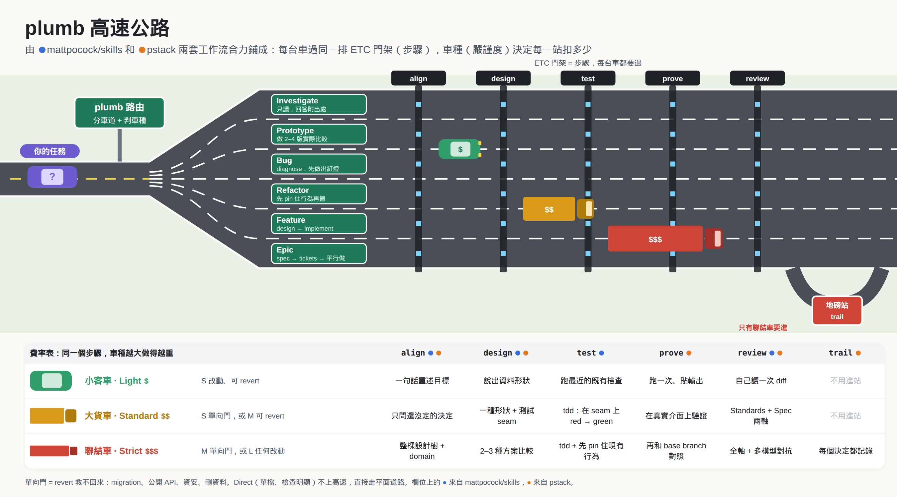

# plumb

<p align="center"></p>



先探到底,再動手;做完拿現實當鉛垂線校正。plumb 是給 coding agent 用的工程流程:每個任務先分「車道」(lane),再依大小與可逆性設定「嚴謹度」(rigor)。

它結合了兩套流程的長處:

- [mattpocock/skills](https://github.com/mattpocock/skills):先對齊再動手(grilling、共享詞彙表、spec、tracer-bullet tickets、兩軸 code review、retro)。
- [cursor/plugins pstack](https://github.com/cursor/plugins/tree/main/pstack):依任務類型路由到 playbook、在真實介面上驗證、把教訓寫成檢查腳本而不是更多文字、何時該問人何時不該問。

## 為什麼結合兩套流程

兩套流程各有長處,也各有不足。下表列出 agent 寫程式時常見的問題、兩邊各自怎麼處理,以及 plumb 最後怎麼做。

| 問題 | Matt 的做法 | pstack 的做法 | plumb 怎麼做 |
| --- | --- | --- | --- |
| Agent 沒搞懂需求就動手 | 動手前一直追問使用者 | 盡量不打擾人,能自己試就自己試 | 先分辨問題:程式裡查得到的自己查,跑一下就知道的自己跑,只有使用者能決定的(例如產品該怎麼表現)才問 |
| 小事流程太重,大事流程太輕 | 一條主流程,從不同入口進入 | 二十多套固定做法,依任務挑一套 | 依任務類型分 6 條車道,再依「改動多大」和「出錯能不能撤回」分 3 級嚴謹度 |
| 改完其實不能用 | 先寫測試再寫程式 | 實際跑起來,看使用者看到的結果 | 兩個都做:先寫測試,完成後再實際跑一次確認 |
| 程式碼越寫越亂,什麼都黏在一起 | 把複雜的部分藏在模組裡,對外只留簡單的介面 | 先決定資料長什麼樣,必要時比較幾種寫法 | 寫程式前先想好別人怎麼呼叫、資料長什麼樣;風險高時同時畫 2 到 3 種設計來比較 |
| 一次做不完的大工作 | 先寫規格,拆成小工作票,互不卡住的票一起做 | 每個 PR 都有人負責,而且要驗證 | 每張票都寫清楚怎麼證明完成,用腳本檢查票之間的先後順序,能同時做的就平行做 |
| 只從一個角度檢查,容易漏 | 分開檢查「寫得好不好」和「有沒有照需求做」 | 讓多個 AI 模型互相挑錯 | 分三個角度各自檢查:寫得好不好、有沒有照需求做、有沒有真的證明能用;風險高時再讓兩個模型互相挑錯 |
| 同樣的錯一直犯 | 回顧之後調整工作環境 | 把教訓變成自動檢查,而不是多寫一段提醒 | `/plumb:retro` 優先把教訓變成能自動擋下錯誤的機制(改結構、加檢查、加測試),最後才寫成文字,並證明新的檢查真的抓得到以前犯過的錯 |

## 車道與嚴謹度

`plumb` 路由 skill 先挑車道:

| 訊號 | 車道 |
| --- | --- |
| 只是問問題 | Investigate |
| 跑起來就能回答的設計問題 | Prototype |
| 壞了、慢了、時好時壞 | Bug |
| 結構要變、行為不能變 | Refactor |
| 新行為,一個 session 做得完 | Feature |
| 跨 session,或終點還看不清楚 | Epic |
| 單檔、檢查明顯、沒有設計選擇 | Direct |

再看大小,並回答三個「門」的問題。三個門各自決定不同的事:

- **改動門**:revert 這次改動能回到原狀嗎?不能的是單向,例如已執行的 migration、別人已在讀的檔案格式或公開 API、資安或金流程式碼。只有這個門決定下表的嚴謹度。
- **設計門**:程式碼可以 revert,但這個形狀之後很難改嗎?例如 schema、公開 API、權限模型。有設計門時,不論嚴謹度都要比較兩到三種設計,並考慮寫 ADR。
- **動作門**:做這個任務時,agent 自己會做不可逆的動作嗎?例如刪資料、部署、force-push、合併、對外發訊息。動作門不提高嚴謹度,只要求在那個動作前停下來問。

例如在既有、會檢查權限的刪除 API 上加一個刪除按鈕:改動門是雙向(revert 就好),測試時刪掉真實資料才是動作門。

| 大小 | 雙向改動門(可 revert) | 單向改動門(已執行的 migration、公開 API、資安、金流) |
| --- | --- | --- |
| S 單一模組 | Light | Standard |
| M 跨模組邊界 | Standard | Strict |
| L 跨子系統或 session | Strict | Strict |

嚴謹度決定每一步有多重。例如 Light 只要一句話確認目標、跑一次最近的檢查,Strict 則要完整 `align` + `domain`、多方案設計、characterization pin、三軸 + 對抗 review、`trail` 決策紀錄。細節在 [skills/plumb/SKILL.md](skills/plumb/SKILL.md)。

證據改變時要重新分類,例如修 bug 時發現原因橫跨三個模組,就從 Light 升到 Standard。

## Epic 主流程

```
(終點看不清楚時先跑 wayfind:決策票地圖 ─► check-tickets.mjs)
align + domain ─► spec ─► tickets ─► check-tickets.mjs
   (同一個 context window,做完 tickets 前不要 clear)
                                      │
                 ┌────────────────────┴───────────────────┐
           implement(每張 ticket 開新 session)     orchestrate(依 frontier 平行)
                 └────────────────────┬───────────────────┘
                            review(三軸)─► deliver ─► /plumb:retro
```

## Skills

模型可自動呼叫:`plumb`(路由)、`align`、`domain`、`design`、`improve-codebase-architecture`(找出可以加深的模組,做成 HTML 報告,選一個後交給 Refactor 車道)、`wayfind`(終點還看不清楚時,畫一張決策票地圖)、`research`(在背景 subagent 讀 repo 外的一手資料並附出處)、`spec`、`tickets`、`implement`、`orchestrate`、`tdd`、`diagnose`、`prove`、`review`、`deliver`、`trail`、`help`(也可以打 `/plumb:help`)、`arena`、`interrogate`、`swarm`、`thermos`、`thermo-nuclear-review`、`thermo-nuclear-code-quality-review`(沒有車道會呼叫這六個)。

只有使用者能呼叫:`/plumb:setup`、`/plumb:retro`、`/plumb:handoff`、`/plumb:sharpen`、`/plumb:ketchup`。

Agents:`plumb-builder`(實作單一 ticket)、`plumb-reviewer`(不改 repo,一次只看一個 review 軸,或驗證一次修正)、`thermo-nuclear-review-subagent` 和 `thermo-nuclear-code-quality-review-subagent`(由 `thermos` 派出)。

## 安裝

先把這個 repo clone 到本機,再把 clone 下來的目錄加成 marketplace:

```bash
git clone https://github.com/paulboul1013/plumb.git plumb
claude plugin marketplace add ./plumb
claude plugin install plumb@plumb-local
```

之後在每個 repo 跑一次 `/plumb:setup`,它會寫出 `docs/agents/plumb.md`(issue tracker、檢查指令、怎麼啟動和操作 app)。

### Hooks

- **SessionStart**:注入路由指令,讓 agent 在任何程式變更前先呼叫 `plumb` skill。
- **Stop(完成閘門)**:只在已跑過 `/plumb:setup`(有 `docs/agents/plumb.md` 或 `.plumb/`)的 repo 生效。工作目錄有未 commit 的變更時,第一次停止會被擋下一次,要求 agent 補印車道與嚴謹度、確認每個步驟完成或寫明跳過理由,並在 Standard 或 Strict 時跑 `review`;如果這些變更是修正已 review 過的改動,就改照 `review` 的 Verify fixes 一節驗證。同一個工作目錄狀態只擋一次,第二次停止一定放行,所以不會無限循環。

- **PreToolUse(builder git 防護)**:只對 `plumb-builder` 子代理生效。它執行 `git stash`、`git reset --hard`、`git checkout -- <路徑>`、`git restore`、`git clean` 會被擋下,並提示改用 `git worktree add` 對照原始版本。主代理和其他子代理不受影響。builder 本身也設定在獨立的 worktree 工作。

- **PreToolUse(PR 發佈防護)**:擋下 `gh pr edit --body`,以及把 `gh pr comment` 和 `git push`、`git commit`、`gh api ... PATCH` 串在同一個指令裡的寫法,並提示改用 `scripts/pr-publish.mjs`。這個腳本會先檢查未填的佔位符、中文、AI 標註和失效的圖片網址,更新內文後讀回比對,最後才送留言。這些檢查假設 PR 全英文且不加 AI 標註,所有用這個外掛的 repo 都適用。

實測發現單靠文字指示,agent 在小 repo 上常會跳過 review;加上這個閘門後,review 才穩定執行,而且在測試中抓到了真的捨入 bug。

### 和 pstack 並存

pstack 的 SessionStart hook 會要求所有任務先走 `poteto-mode`,和 plumb 的路由衝突。兩個都裝時,關掉其中一個 hook:

- 關 pstack 的:在 `~/.claude/pstack-models.md` 把 `session hook: on` 改成 `session hook: off`。
- 關 plumb 的:設定環境變數 `PLUMB_HOOK=off`。

pstack 的 skill(`arena`、`interrogate` 等)關掉 hook 後仍可手動使用。plumb 現在也有自己的 `arena`、`interrogate`、`swarm`、`thermos`、`thermo-nuclear-review`、`thermo-nuclear-code-quality-review` 副本,放在 `plumb:` namespace 下,plumb 的 `review` 和車道都不會呼叫它們。

完整的切換步驟(用 plumb、換回 pstack、兩邊都關)見 [docs/pstack-conflict.md](docs/pstack-conflict.md)。

## 使用方式

### 1. 每個專案先設定一次

在專案目錄開 Claude Code,輸入:

```
/plumb:setup
```

agent 會先讀 repo(git remote、`package.json` 等設定檔、CI、詞彙表,不論叫 `GLOSSARY.md`、`CONTEXT.md` 或其他名稱),再提出一份草稿讓你確認,內容包括:

- **Tracker**:ticket 放哪裡。可以是 GitHub、GitLab,或本機的 `.plumb/<功能名>/tickets/`。選 GitHub 或 GitLab 時,也會記下目標 repo 的 `owner/name`。
- **Checks**:typecheck、lint、單一測試檔、完整測試的指令。
- **Run surface**:怎麼啟動 app、怎麼操作它來驗證。
- **Domain docs**:詞彙表的實際路徑(例如 `GLOSSARY.md` 或 `CONTEXT.md`)和 ADR 放哪裡。

確認後會寫出 `docs/agents/plumb.md`,並在 `CLAUDE.md` 或 `AGENTS.md` 加一行指向它。之後可以直接手改這個檔案。

設定完成後,這個 repo 也會啟用 Stop 完成閘門。

### 2. 平常怎麼用:直接描述任務

不用記指令。直接用一般的話描述你要做的事,agent 會先呼叫 `plumb` 路由,印出一行分類,例如:

```
lane: Bug · rigor: Light (S, two-way) · why: 只改 cart.js 的加總邏輯
```

然後照那條車道的步驟做。各車道的說法範例:

| 你說 | 車道 | agent 會做的事 |
| --- | --- | --- |
| 「購物車數量 2 的時候總價算錯」 | Bug | 先做出一個會在這個 bug 上失敗的指令,再找原因、修、證明修好 |
| 「把 auth 模組拆成兩個檔案,行為不要變」 | Refactor | 先用測試釘住目前行為,刪多餘的東西,再小步搬移,每步都保持測試通過。還不知道要重構哪裡時(「這個 codebase 越來越難改,幫我找重構目標」),先跑 `improve-codebase-architecture` |
| 「訂單加上折扣碼功能」 | Feature | 對齊需求、設計資料形狀和測試 seam、TDD 實作、實際跑、review |
| 「我們要做多租戶,先規劃」 | Epic | 完整對齊、寫 spec、切 tickets,再一張一張或平行實作 |
| 「列表用卡片還是表格比較好?做出來看看」 | Prototype | 在暫存位置做 2 到 4 個可切換的版本,截圖比較,給建議 |
| 「這個 retry 機制是怎麼運作的?」 | Investigate | 只讀不改,回答時附上檔案和行號 |

如果分類不對,直接糾正就好,例如「這是單向改動門,用 Strict」或「這很小,用 Light」。

### 3. agent 問你問題時

`align` 只會問只有你能決定的事(產品行為、範圍、命名、取捨)。查得到的事實和跑得出來的問題,agent 會自己處理。

問題會一輪一輪來,每題附上建議答案:

```
**Q1. 折扣碼可以疊加嗎?** 一張訂單用多個碼,還是只能用一個?

Recommended: 只能一個。疊加的計算順序會牽涉到退款邏輯,之後再做。
```

回答「yes」就是接受建議;不同意就直接說你的答案。可以一次回多題,例如「Q1 yes,Q2 改成每月重置」。

### 4. 大型工作(Epic)

Epic 車道的流程:

1. **對齊和 spec。** 對齊、寫 spec、切 tickets 這幾步要在同一個 session 裡做完,中間不要 `/clear`。如果還說不出「做完長什麼樣」,agent 會先跑 `wayfind`:在 `.plumb/<功能名>/map.md` 畫地圖,每個還沒決定的問題寫成 `.plumb/<功能名>/decisions/` 下的一張決策票(research、prototype、align、task 四種),一個 session 只解一張(research 票例外,交給 `research` 平行跑)。同一支 `check-tickets.mjs` 也能檢查地圖:`node <plumb 目錄>/scripts/check-tickets.mjs .plumb/<功能名>/decisions`,GitHub 上則傳 `plumb:map` issue 的編號。
2. **確認 tickets。** agent 會列出 tickets 和它們的依賴,問你粒度和依賴對不對。確認後寫進 tracker。用本機 tracker 時,可以自己檢查 ticket 和看哪些可以開工:

   ```bash
   node <plumb 目錄>/scripts/check-tickets.mjs .plumb/<功能名>/tickets
   node <plumb 目錄>/scripts/check-tickets.mjs .plumb/<功能名>/tickets --frontier
   ```

   用 GitHub tracker 時,tickets 是 spec issue 的 sub-issue,改成:

   ```bash
   node <plumb 目錄>/scripts/check-tickets.mjs --github <owner/repo> <spec issue 編號>
   node <plumb 目錄>/scripts/check-tickets.mjs --github <owner/repo> <spec issue 編號> --frontier
   ```

   `<plumb 目錄>` 是[安裝](#安裝)時 clone 下來的那個目錄。GitHub 上建立 issue、掛 sub-issue、加 blocking 連結、認領和關閉 ticket 的指令在 [skills/setup/GITHUB.md](skills/setup/GITHUB.md)。

3. **選一種實作方式:**
   - 一張一張做:每張 ticket 開新 session,說「implement ticket 03」。
   - 一次做完:說「orchestrate 這個 spec」,agent 會依依賴關係平行開多個 builder,合併到同一條 integration branch。
4. **最後** 整條 branch 跑一次 review,再整理 commit 和 PR。

### 5. 讓它自己跑

說「我要離開,你自己跑完」或「不用問我」,agent 會改用建議答案繼續,並把每個代替你做的決定記在 `.plumb/trail.tsv`。最後的回覆會列出這些決定,讓你回來時可以推翻。

即使你這樣說,下列動作仍然會停下來問你:force-push 共用分支、部署、刪資料、對外發訊息、merge。

### 6. 只有你能呼叫的指令

| 指令 | 用途 | 什麼時候用 |
| --- | --- | --- |
| `/plumb:setup` | 設定這個 repo | 每個專案第一次用之前 |
| `/plumb:retro` | 回顧這個 session 和跨 repo 的錯誤紀錄(`failure-log.mjs`),把犯過的錯變成 lint、測試或規範 | 做完一件事之後,尤其是過程不順的時候 |
| `/plumb:handoff` | 寫一份交接檔到 repo 裡的 `.plumb/handoffs/<日期>-<名稱>.md`(不進 git),讓另一個 session 或別人接手 | 換目錄、換工具、交給別人、或要暫停很久 |
| `/plumb:sharpen` | 用四個問題(專家會多做什麼、最原始的材料、方法、外部檢驗)把任務做深,改寫成更好的 prompt,不動手做 | 開工前覺得需求太淺、太籠統,想先拉高標準再交給 `/plumb:plumb` |
| `/plumb:ketchup` | 從你最後一則訊息開始,用白話補上發生了什麼,列出每個等你決定的事(附建議、依據、風險)。只讀不改 | 離開一陣子回來、plumb 在背景跑很久,想知道現在怎樣、有什麼要你決定 |

### 7. 手動呼叫單一 skill

不知道該用哪個時,先問 `/plumb:help`,例如「/plumb:help 我想修一個偶爾才會發生的 bug」,它會告訴你會走哪條車道、跑哪些 skill,並給一個範例 prompt。

不想走完整車道時,可以直接叫單一 skill:

- `/plumb:tdd`:只用 red-green 寫測試和實作。
- `/plumb:diagnose`:只做除錯流程。
- `/plumb:review`:review 目前分支,例如「review 從 main 到現在的變更」。
- `/plumb:align`:只要被問問題、把想法釐清。
- `/plumb:prove`:只驗證某個變更真的能用。
- `/plumb:arena`、`/plumb:interrogate`、`/plumb:swarm`、`/plumb:thermos`、`/plumb:thermo-nuclear-review`、`/plumb:thermo-nuclear-code-quality-review`:平行候選、對抗式挑錯、平行 worker 和嚴格審查。沒有車道會呼叫它們,只有你要求或需求符合時才會跑。

### 8. 怎麼確認它有在運作

- 每次改程式前,agent 會先呼叫 `plumb:plumb`,並印出 `lane: ... · rigor: ...`。
- 最後的回覆會以同一行分類開頭,並附上實際跑出來的輸出。
- 在設定過的 repo,如果 agent 還沒 review 就想停,會看到它被完成閘門擋下一次,然後補跑 review。

## 檢查腳本

```bash
node scripts/check-plugin.mjs        # frontmatter、連結、user-invoked 引用方式、路由清單、禁止長破折號、詞彙表檔名寫死、只看 commit 的 review diff
node scripts/review-diff.mjs <ref>   # review 要看的完整 diff:commit、未 commit 的修改、新檔案
node scripts/record.mjs <slug> <name> -- <command>   # 跑驗證指令並存成證據檔 .plumb/<slug>/evidence/<時間>-<name>.log,記下 commit、diff 摘要和 exit code
node scripts/record.mjs <slug> <name> --note         # 把 stdin(review 報告、截圖路徑)存成同樣的證據檔
node scripts/record.mjs --digest                     # 印出工作樹對 HEAD 的 diff 摘要,reviewer 拿它比對證據檔的 diff 行
node scripts/failure-log.mjs add --context <t> --cause <t> --fix <t> [--lane L] [--skill S] [--tag T]   # agent 修正自己的錯時記一筆到跨 repo 的 ~/.plumb/failures.jsonl,自動填時間、repo、branch、commit 和 session
node scripts/failure-log.mjs list [--here | --repo <字串>] [--since YYYY-MM-DD] [--open] [--json]   # 列出記過的錯,新的在前;--open 只列還沒變成檢查的
node scripts/failure-log.mjs encode <id> --by <commit 或檔案>   # 標記某筆錯已經變成檢查,之後的 retro 不再列出
node scripts/check-tickets.mjs <dir> # ticket 編號、依賴、狀態、Acceptance 與 Proof
node scripts/check-tickets.mjs <dir> --frontier   # 列出現在可以開工的 tickets
node scripts/check-tickets.mjs --github <owner/repo> <spec-issue> [--frontier]   # 同樣的檢查,讀 GitHub spec issue 的 sub-issue(gh 2.45 以上)
node --test scripts/test/*.test.mjs# 腳本本身的測試
```

## 授權與來源

MIT。部分內容改寫自 mattpocock/skills(MIT,Matt Pocock)和 cursor/plugins 的 pstack(MIT,Lauren Tan)。`skills/tdd/tests.md`、`skills/tdd/mocking.md`、`skills/domain/GLOSSARY-FORMAT.md`、`skills/domain/ADR-FORMAT.md` 直接取自 mattpocock/skills。`skills/improve-codebase-architecture/HTML-REPORT.md` 取自 mattpocock/skills,只在 Mermaid 初始化加上 `deterministicIds: true`,避免多張圖在同一毫秒渲染時 id 相撞、畫進同一個框。`wayfind`、`research`、`improve-codebase-architecture` 改寫自 mattpocock/skills 的 `wayfinder`、`research`、`improve-codebase-architecture`。`arena`、`interrogate`、`swarm`、`thermos`、`thermo-nuclear-review`、`thermo-nuclear-code-quality-review` 這六個 skill 和兩個 thermo subagent 移植自 pstack-claude 0.9.132。`arena`、`interrogate`、`swarm` 的著作權屬於 Lauren Tan,pstack-claude 的修改屬於 Michael Denyer;`thermos`、兩個 thermo-nuclear review skill 和兩個 subagent 的著作權屬於 Cursor(都是 MIT),授權全文在 [docs/licenses/](docs/licenses/)。
